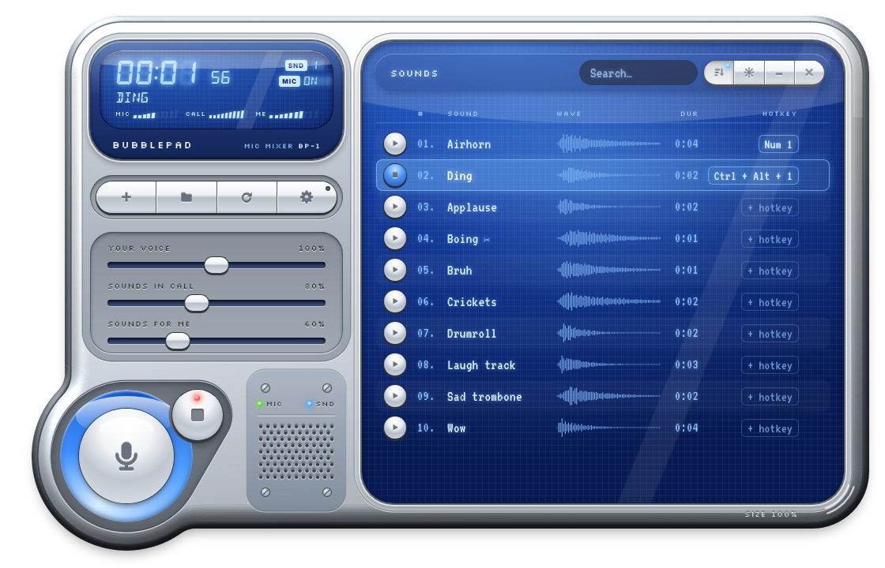
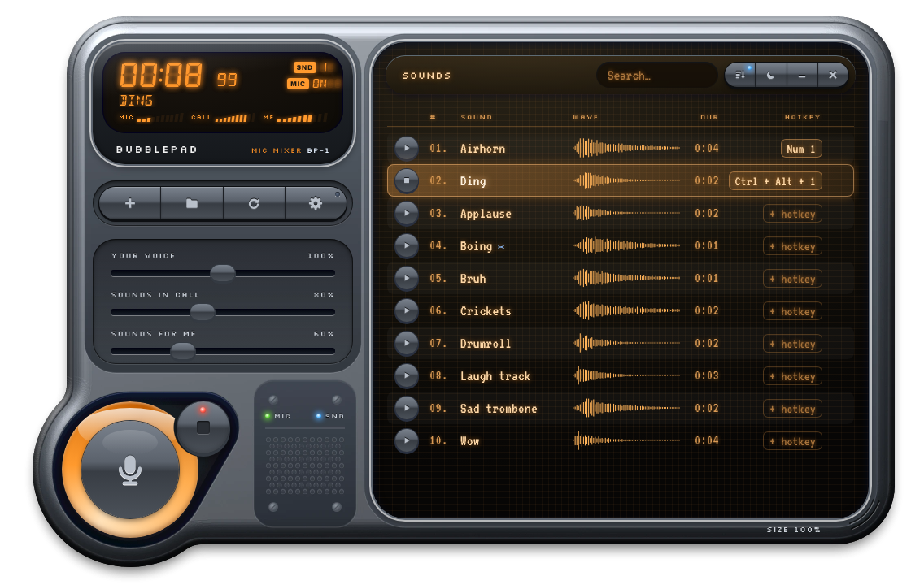
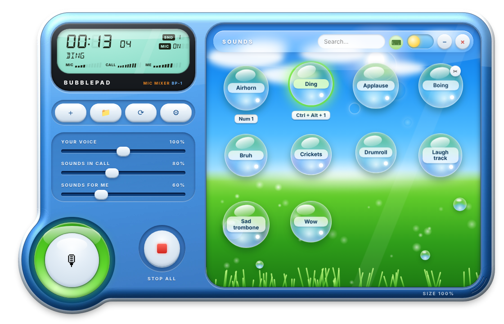
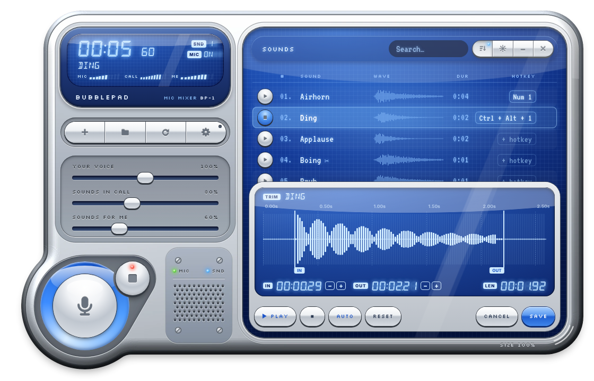
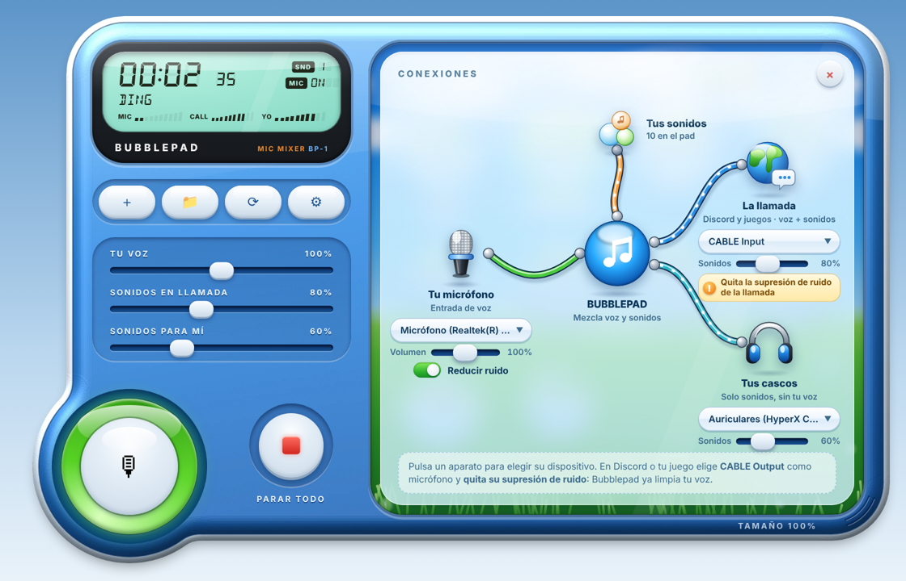

<p align="center"></p>

<h1 align="center">Bubblepad</h1>

<p align="center"><b>Free soundboard for Windows that plays sounds through your microphone.</b><br>
Mixes your real mic and your sound effects into <b>one virtual microphone</b>, so people hear both in <b>Discord, games, Zoom, Teams</b> or any voice chat.</p>

<p align="center"><a href="#english">English</a> · <a href="#español">Español</a></p>

<p align="center"></p>

---

## English

### What it does
Discord and games only listen to **one** input device. Bubblepad sits in the middle:

```
your real mic  ─┐
                ├─►  CABLE Input  ──►  Discord / game hears your voice + your sounds
sound effects ──┤
                └─►  your headphones (sounds only, so you don't hear your own voice echo)
```

If you have ever searched for *"how to play sounds through my mic"*, *"soundboard for Discord that I can also hear"* or *"mix microphone and soundboard into one input"*, this is that.

### Features
- 🎙 **Mic + soundboard mixer** into a single virtual microphone (uses the free VB-CABLE driver)
- 🎧 **You hear the sounds too**, but not your own voice
- 🧹 **Built-in noise reduction** for your voice (RNNoise), so you can switch off Discord's, which would filter out your sounds
- 🔌 **Visual connections panel**: see your mic, the pad, the call and your headphones joined by cables, and click any of them to pick the device
- ⌨ **Global hotkeys**: work while the window is minimized or hidden in the tray (Ctrl/Alt/Shift combos, F-keys, numpad)
- ✂ **Trim editor** with waveform and **one-click silence removal** (non-destructive, your files are never modified)
- 🔊 Separate volumes for your voice, sounds in the call and sounds for you
- 💿 **Two looks**: *Chrome*, a 2000s media-player skin with a playlist and real waveforms, and *Aqua*, the Frutiger bubbles
- 🌙 **Day / night** in both (graphite & amber at night), Casio-style LCD with live meters
- 🫧 Tray icon, mute button, stop-all, search, sort by hotkey, resizable window (80–120 %)
- 🌍 English and Spanish
- 🔌 One-click VB-CABLE setup if it's missing
- 🛡 Auto-recovers if your headset sleeps or reconnects

<p align="center"> </p>
<p align="center"></p>

<p align="center"></p>

### Install
Download from [Releases](../../releases) one of the two versions:

| | File | How |
|---|---|---|
| **Installer** (recommended) | `Bubblepad-Setup.exe` | Run it: it installs Bubblepad for your user (no admin needed), with a Start menu shortcut and an uninstaller. |
| **Portable** | `Bubblepad-windows.zip` | Unzip it anywhere (a USB stick works too) and run `Bubblepad.exe`. Nothing is installed. |

Then:
1. Open Bubblepad.
2. If you don't have **VB-CABLE** yet, Bubblepad offers to install it in one click (it downloads the official installer from [vb-audio.com](https://vb-audio.com/Cable/); press *Install Driver*) and then restart your PC.
3. In **Discord** (or your game): *Settings → Voice → Input device* → **CABLE Output (VB-Audio Virtual Cable)**.
4. In Discord, turn **off Noise Suppression and Echo Cancellation**, otherwise it treats your sounds as background noise. Don't worry about your voice: Bubblepad's **Reduce noise** switch (on by default, in ⚙ → *Connections*) already cleans it.

Add sounds with **＋** (mp3, wav, ogg, flac). Right-click a bubble to set a hotkey, trim or delete it.

### Run from source
Requires Python 3.11+ on Windows. Double-click **`Iniciar Bubblepad.bat`**: it creates a virtual environment, installs the dependencies and starts the app. To build the `.exe`, run **`Compilar exe.bat`** (PyInstaller) and grab `dist/Bubblepad-windows.zip`.

Built with Python, PySide6 (Qt WebEngine for the UI), sounddevice/PortAudio (WASAPI), miniaudio and numpy.

### FAQ
- **People hear my sounds but I don't** → check "I listen on" in ⚙ and the *Sounds for me* slider.
- **Sounds play but nobody hears them** → Discord's input must be *CABLE Output*, and noise suppression off.
- **Why can't Discord's noise suppression stay on?** It only sees one microphone, so it can't tell your sounds from background noise and filters them out. Bubblepad cleans your voice *before* mixing it with the sounds, so you get the same result without losing your effects.
- **Hotkeys don't work inside a game (e.g. League of Legends)** → the game runs as administrator, so Windows blocks its keystrokes from reaching normal apps. In ⚙ → *Games*, press **Restart as administrator** (or tick *Always open as administrator*).
- **A hotkey doesn't work anywhere** → another app already uses that combination; Bubblepad will tell you.

---

## Español

### Qué hace
Discord y los juegos solo escuchan **un** micrófono. Bubblepad se pone en medio: mezcla **tu micro real y tus sonidos** en un **micro virtual** (VB-CABLE), y a ti te deja oír los sonidos en tus cascos sin escuchar tu propia voz.

Si alguna vez has buscado *"cómo poner sonidos por el micro en Discord"*, *"soundboard que suene por el micrófono"* o *"mezclar micro y soundboard en una sola entrada"*, es esto.

### Funciones
- 🎙 Mezclador de micro + soundboard en un solo micro virtual
- 🎧 Tú también oyes los sonidos (pero no tu voz)
- 🧹 **Reducción de ruido integrada** para tu voz (RNNoise): puedes quitar la de Discord, que filtraría tus sonidos
- 🔌 **Panel de conexiones visual**: micro, pad, llamada y cascos unidos por cables; pulsa cualquiera para elegir el dispositivo
- ⌨ Atajos de teclado globales, también con la ventana minimizada o escondida
- ✂ Editor de recorte con forma de onda y botón para **quitar silencios** (sin tocar el archivo original)
- 🔊 Volúmenes separados: tu voz, sonidos en llamada y sonidos para ti
- 💿 Dos aspectos: *Chrome* (reproductor de los 2000, lista con ondas reales) y *Aqua* (burbujas Frutiger)
- 🌙 Día y noche en ambos, pantalla LCD estilo Casio
- 🫧 Icono en la bandeja, silenciar micro, parar todo, búsqueda, orden por atajos, ventana redimensionable
- 🌍 Español e inglés

### Instalación
Descarga de [Releases](../../releases) una de las dos versiones:

- **Instalador (recomendado):** `Bubblepad-Setup.exe`. Se instala para tu usuario (sin permisos de administrador), con acceso directo en el menú Inicio y desinstalador.
- **Portable:** `Bubblepad-windows.zip`. Descomprímelo donde quieras (también en un USB) y abre `Bubblepad.exe`. No instala nada.

Después:
1. Abre Bubblepad.
2. Si no tienes **VB-CABLE**, Bubblepad te lo instala con un clic (descarga el instalador oficial de [vb-audio.com](https://vb-audio.com/Cable/); pulsa *Install Driver*) y luego reinicia el PC.
3. En **Discord** (o tu juego): *Ajustes → Voz y vídeo → Micrófono* → **CABLE Output (VB-Audio Virtual Cable)**.
4. Desactiva en Discord la **supresión de ruido** y la **cancelación de eco**, o tratará tus sonidos como ruido. Tu voz no pierde nada: el interruptor **Reducir ruido** de Bubblepad (activado por defecto, en ⚙ → *Conexiones*) ya la limpia.

**¿Los atajos no funcionan dentro de un juego (p. ej. LoL)?** El juego se abre como administrador y Windows no deja pasar sus pulsaciones. En ⚙ → *Juegos* pulsa **Reiniciar como administrador**.

### Desde el código
Con Python 3.11+ en Windows: doble clic en **`Iniciar Bubblepad.bat`**. Para crear el `.exe`: **`Compilar exe.bat`**.

---

**Design & product direction:** [civercras](https://civercras.github.io) · **Development:** AI-assisted (Claude)

Licence: MIT. Segment display fonts: [DSEG](https://github.com/keshikan/DSEG) (SIL Open Font License). Noise reduction: [RNNoise](https://github.com/xiph/rnnoise) (BSD 3-Clause, via [pyrnnoise](https://github.com/pengzhendong/pyrnnoise)). VB-CABLE is © VB-Audio and is installed separately.

<sub>Keywords: soundboard, discord soundboard, play sounds through mic, mic mixer, virtual microphone, virtual audio cable, VB-CABLE, sound effects, voice chat, gaming, Windows, free, open source, Soundpad alternative, Voicemod soundboard alternative.</sub>
